# Okta IAM Lifecycle Lab

**Identity & Access Management lab: user provisioning, group-based application access, MFA policy enforcement, and deprovisioning — built and tested end-to-end in Okta.**

Completed November 1, 2026 · Okta Integrator (free) org · Solo lab

## What this lab demonstrates

| IAM skill | How it was demonstrated |
|---|---|
| User provisioning (joiner) | Created 3 test users and placed each into a role group |
| Group-based access control | Assigned the Box application to **groups**, never to individuals |
| MFA enrollment policy | Custom policy (priority 1) requiring Email + Okta Verify + Password for test groups only |
| MFA at sign-in | Global session policy rule: MFA **required, at every sign-in** |
| Access testing (positive) | SOC and Helpdesk users signed in through MFA and received Box |
| Access testing (negative) | Contractor signed in through MFA but received **no** application |
| Deprovisioning (leaver) | Contractor deactivated; session cleared; re-login attempt **failed** |
| Evidence & logging | Every result verified in the Okta System Log (export + screenshots) |

## Scenario

A small org has three roles that need different access:

- **SOC-Analysts** — needs the Box application
- **IT-Helpdesk** — needs the Box application
- **Contractors** — gets an account and MFA, but **no** Box access, and is the
  first account removed when the engagement ends

Each test user was created with a plus-addressed address on one controlled
inbox (`+soc`, `+helpdesk`, `+contractor`), so activation, verification, and
recovery mail for every identity was actually receivable — a fake address
would have made the sign-in tests impossible to complete honestly.

## Step 1: Confirm the authenticators

Okta Verify, Email, Passkey (FIDO2 WebAuthn), and Password were all **Active**
before any policy was written.

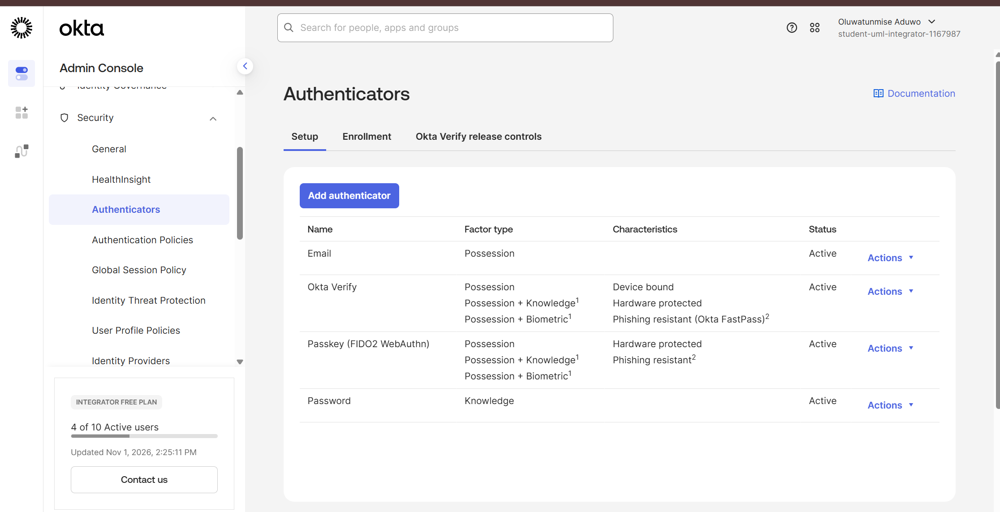

## Step 2: Enrollment policy: make MFA required for test users only

The built-in Default Policy applies to **Everyone** and only *optionally*
offers Okta Verify. Instead of editing it (which would have changed the
admin account too), I created a separate enrollment policy:

- **Lab Test MFA — Priority 1** (above Default), assigned only to
  Contractors, IT-Helpdesk, and SOC-Analysts
- **Required:** Email, Okta Verify, Password · **Optional:** Passkey

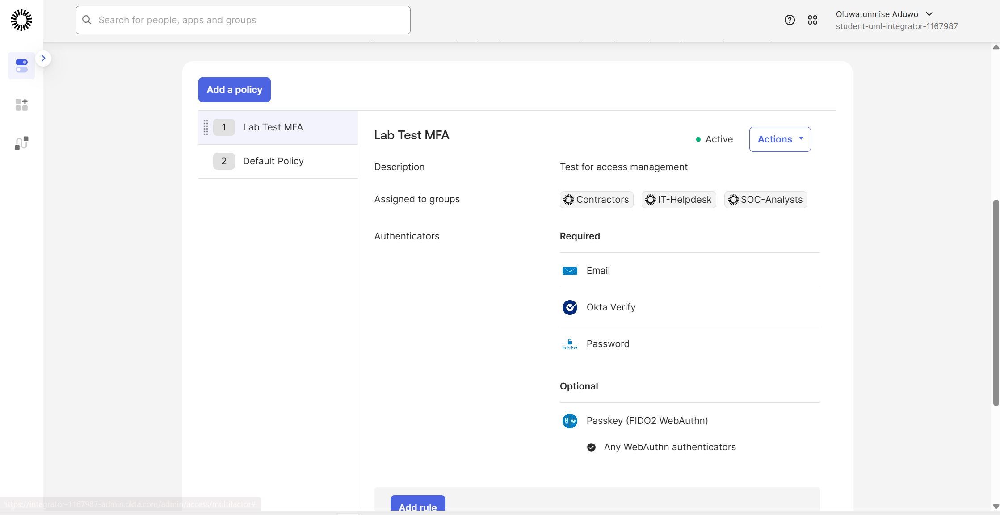

## Step 3: Global session policy: MFA at every sign-in

A second, test-groups-only global session policy carries one rule:
access allowed, **Multifactor authentication: Required**, and
**users will be prompted for MFA at every sign in** — not once, not per
device.

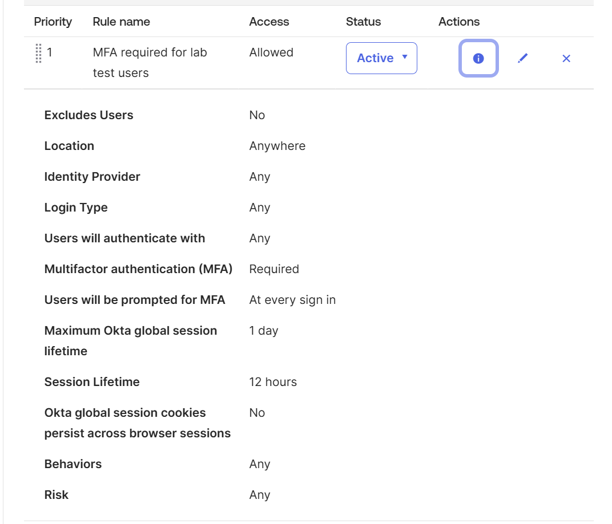

## Step 4: Assign the application by group

Box was assigned so that Test User 1 (SOC) and Test User 2 (Helpdesk) hold
it **via Group** membership. The contractor appears nowhere in the
assignment list — the denial is structural, not a per-user exception.

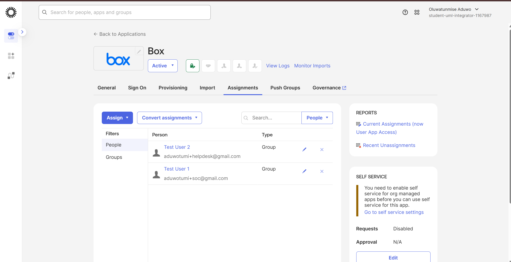

## Step 5: Sign-in tests (private browser window)

Signing in as the SOC user forced both required factors in sequence:
first an **email verification** challenge…

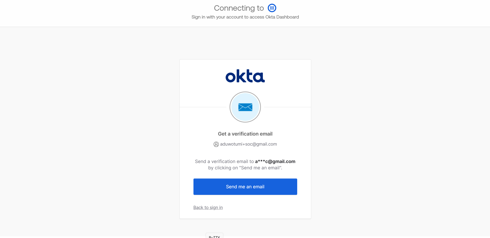

…then **Okta Verify enrollment ("Required now")** before the dashboard
would load.

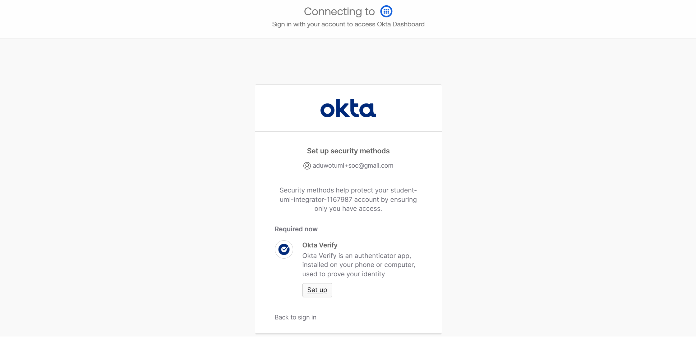

## Test results

| User | Group | MFA enforced | Box app |
|---|---|---|---|
| Test User 1 | SOC-Analysts | Email + Okta Verify | Present |
| Test User 2 | IT-Helpdesk | Email + Okta Verify | Present |
| Test User 3 | Contractors | Email + Okta Verify | Absent |

**SOC Analyst — Box present in the Work section:**

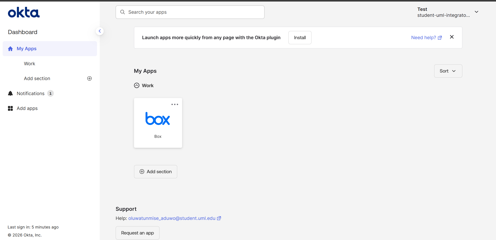

**IT Helpdesk — Box present in the Work section:**

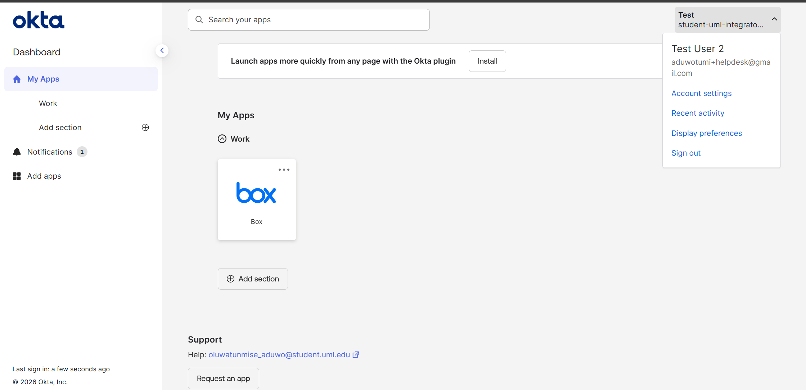

**Contractor — signed in, Work section empty:**

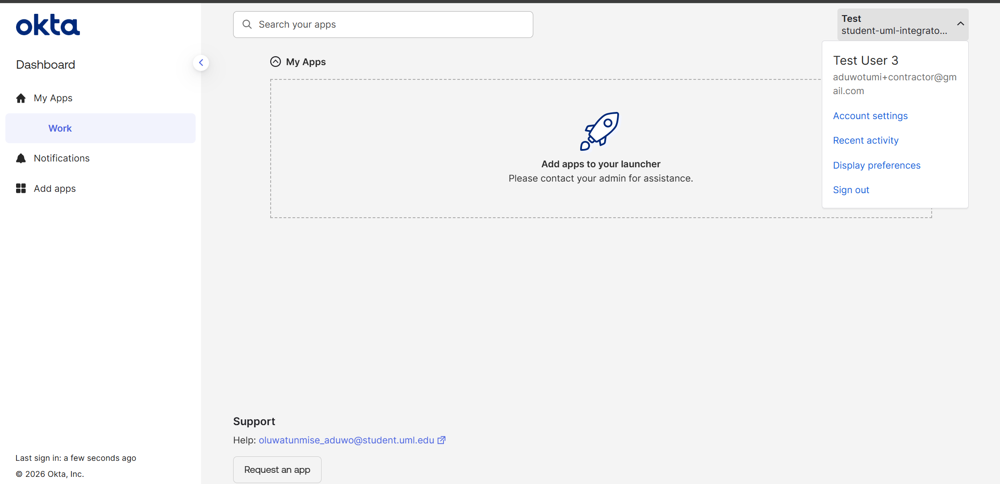

## Step 6: Deprovision the contractor

The contractor account was deactivated from the admin console. The People
list then showed **Test User 3: Deactivated**, with all other accounts
still Active.

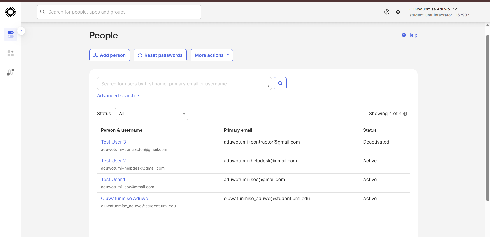

A fresh sign-in attempt as the deactivated contractor failed at the
password step; deactivation blocks access, it doesn't just change a
label:

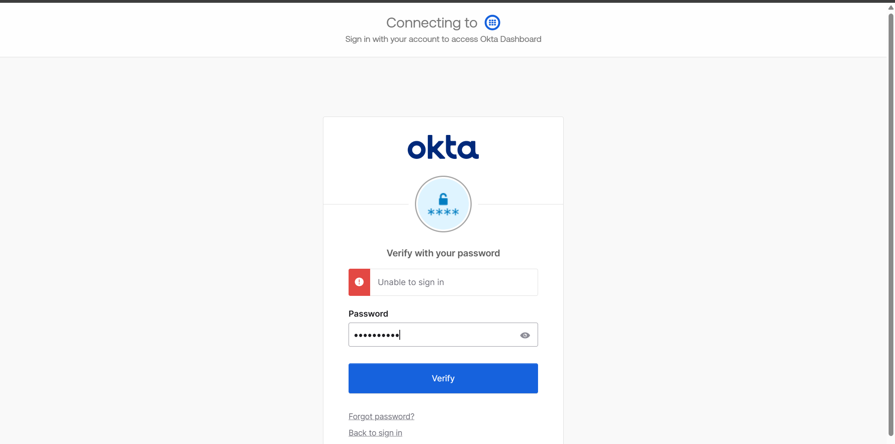

## Evidence: System Log

The System Log confirms the full sequence, including the two events that
close the lab (times ET):

- **15:10:38** — *Clear user session* → Test User 3 — SUCCESS
- **15:10:38** — *Deactivate Okta User* → Test User 3 — SUCCESS
- **15:12:02** — *User login to Okta* (contractor) — **FAILURE:
  VERIFICATION_ERROR**

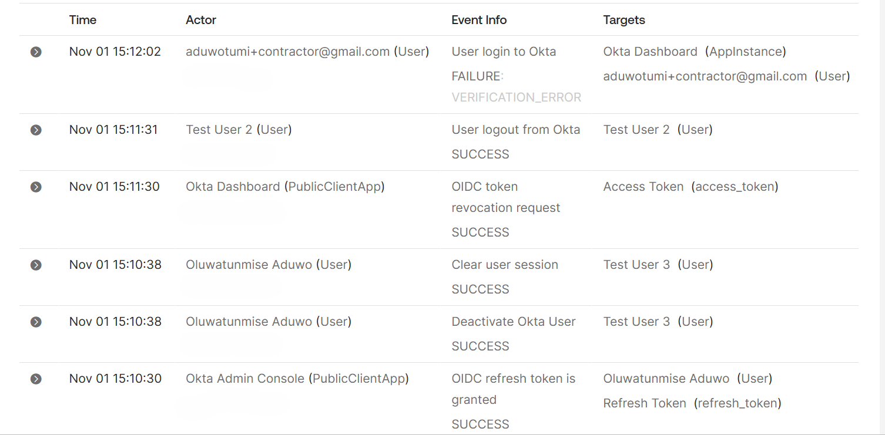

The full log export (356 events) also shows `group.application_assignment.add`
for both Box group assignments, `user.mfa.factor.activate` for every test
user, and `user.authentication.auth_via_mfa` SUCCESS for all three sign-in
tests. The raw export is **not** published here — it contains IP addresses
and session identifiers. The screenshot above is a cropped version with
no IP addresses shown.

## What production would do differently

In a real organization this lifecycle is driven, not hand-clicked: an HR
system as the source of truth, SCIM provisioning/deprovisioning into Okta
and downstream apps, group rules that map job role to group membership
automatically, and periodic access certifications re-reviewing who still
needs what. This lab is that same logic, executed manually so every step 
and every failure mode is visible.

## Tools used

Okta (Integrator Free Plan) | Okta Verify mobile app | Box (catalog app
used as the group-assigned test application)

## Author

Oluwatunmise Aduwo — Computer Science (Cybersecurity), UMass Lowell,
Class of 2026.
